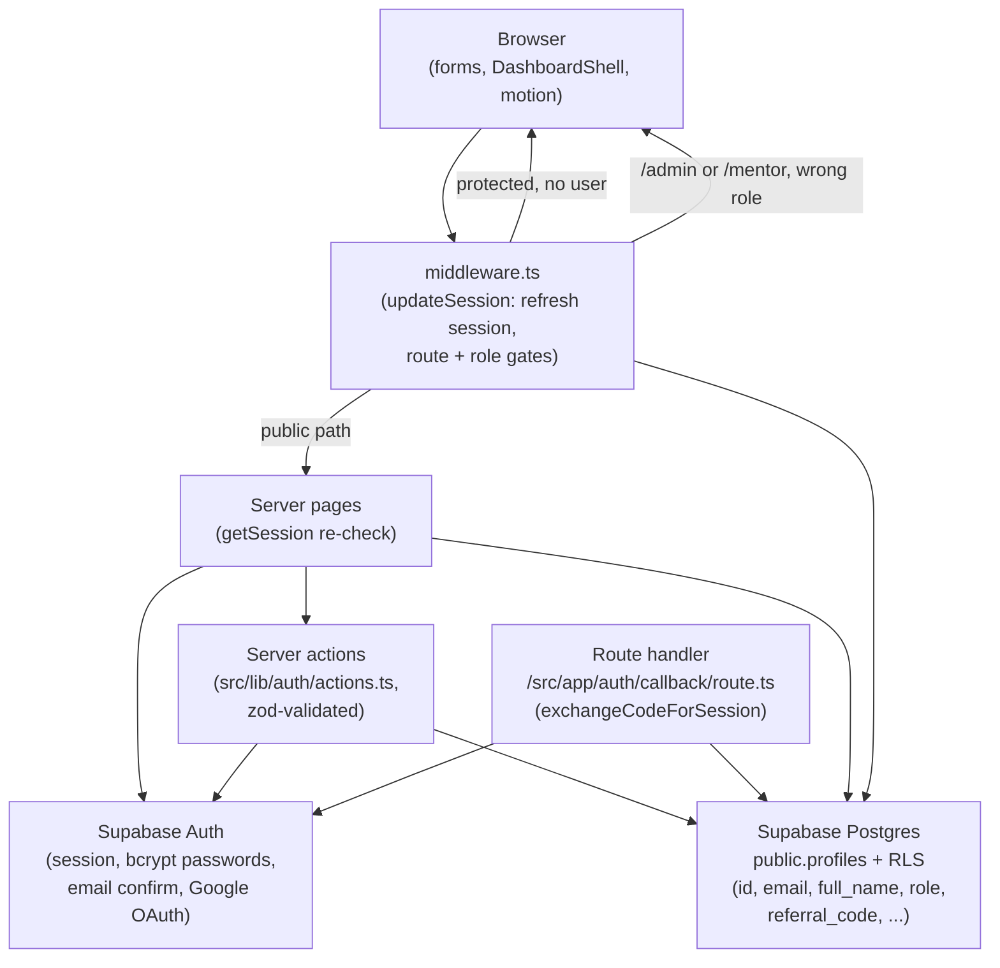
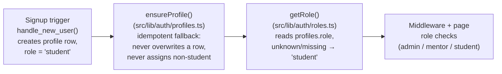

# TGL Architecture

Touch Grass Later (TGL) is a Next.js 14 App Router application whose current
scope is the authentication experience plus the motion system: login, signup,
password recovery, email verification, OAuth callback, and role-based homes
for `student`, `mentor`, and `admin`. There is no course, project, or wallet
backend yet — the dashboard pages render static placeholder stats. This
document describes the system as it exists on `main` (tip `245fa3f`), not as
planned. Every claim below was read from the code it names.

## Stack (verified from `package.json`)

| Layer | Choice |
| --- | --- |
| Framework | Next.js `^14.2.5` (App Router), React `^18.3.1`, TypeScript `^5.5.0` |
| Auth + data | Supabase: `@supabase/ssr ^0.5.2`, `@supabase/supabase-js ^2.45.0` |
| Validation | `zod ^3.23.8` on server actions |
| Motion | `framer-motion ^11.11.0` |
| Styling | Tailwind CSS `^3.4.10` |

Only the public anon key is used anywhere in the repo. The service-role key
is never referenced; role grants happen via the Supabase dashboard /
service role outside this codebase.

## Request flow

Notes on the diagram, each tied to code:

- **Middleware runs first, on every matched request** (`middleware.ts`,
  matcher excludes `_next/static`, `_next/image`, `favicon.ico`, and image
  extensions). It calls `updateSession` (`src/lib/supabase/middleware.ts`),
  which refreshes the session from cookies and returns the user.
- **Public paths** (`/`, `/login`, `/signup`, `/forgot-password`,
  `/reset-password`, `/verify-email`, `/auth/callback`, `/access-denied`,
  `/session-expired`) render without a session. Every other path redirects
  an anonymous user to `/login?next=<safe-path>`.
- **Signed-in users visiting `/login` or `/signup`** are redirected to the
  `next` target if it passes `safeNext` (`src/lib/url.ts`, open-redirect
  guard), otherwise to their role home.
- **Role gates in middleware:** `/admin` requires role `admin`;
  `/mentor/...` requires any role other than `student`; anything else goes
  to `/access-denied`. These are server-side checks, not hidden navigation.
- **Pages re-verify (defense in depth).** Each role home calls
  `getSession()` (`src/lib/auth/session.ts`): no user → redirect to
  `/login`; wrong role → `/access-denied`. Dashboard pages are
  `force-dynamic`, so a cached redirect can never be served for them.

## The three Supabase clients

The codebase keeps three separate clients because each runs in a different
runtime, and mixing them up breaks cookie handling:

| Client | File | Used by |
| --- | --- |
| Browser (singleton) | `src/lib/supabase/client.ts` | Only the reset-password form's `getSession()` check |
| Server | `src/lib/supabase/server.ts` | Server Components, Server Actions, Route Handlers (cookie store via `next/headers`) |
| Middleware | `src/lib/supabase/middleware.ts` | `middleware.ts` only (reads/writes request + response cookies, refreshing the session per request) |

All three use the anon key only. If Supabase is not configured, pages
render an explicit configuration state instead of faking authentication
(`isSupabaseConfigured`, `src/lib/auth/config.ts`).

## Where roles come from (the trust chain)

- **Roles come only from the server-side `profiles` table** — never from
  form fields, URL params, or browser storage. Signup forms carry no role
  field.
- **Signup trigger is the primary path:** `handle_new_user()` in
  `supabase/migrations/20261006_profiles.sql` creates the profile row
  exactly once, always as `student`.
- **`ensureProfile()` is the fallback** (used by server actions and the
  auth callback): if a row already exists it returns without touching it,
  so a role granted by an admin is preserved; if none exists it inserts
  `student` only. It is idempotent, so callback retries are safe.
- **Role updates are guarded in the database:** the
  `prevent_role_self_change` trigger blocks client-side role changes; the
  update policy otherwise allows a user to update only their own row.
- **Known gap on `main` (not hidden):** the profiles INSERT policy checks
  only `auth.uid() = id`, so a user with no profile row could in principle
  self-insert with any role. This is normally unreachable because the
  signup trigger pre-creates the `student` row and the primary key blocks
  a second insert. The fix — constraining the INSERT policy to
  `role = 'student'` — exists on the unmerged branch
  `day18-insert-role-student` and still needs its live-database re-apply
  before it protects anything.

## Auth flows

- **Email signup/signin:** server actions in `src/lib/auth/actions.ts`,
  zod-validated (email format, password ≥ 8 chars, terms accepted,
  password confirmation match). Errors are mapped to friendly messages
  (invalid credentials, duplicates, expired links, rate limits) without
  revealing whether an email exists on the forgot-password path.
- **OAuth / email links:** `/auth/callback` exchanges the code for a
  session (`exchangeCodeForSession`), runs `ensureProfile`, reads the role,
  and redirects to the safe `next` target or the role home. Failures go to
  `/login?error=callback_failed`.
- **Password recovery:** `/forgot-password` requests a reset link;
  `/reset-password` sets the new password (its form is the one place the
  browser client is used, for a session check). Expired links render an
  explicit expired-link state.

## Presentation layers

- **Routes** (`src/app/`): landing page, auth pages, three role homes,
  plus `/access-denied` and `/session-expired`. Each auth page pairs a
  server `page.tsx` with a client form component (e.g. `LoginForm`,
  `SignupForm`).
- **Components:** `src/components/ui/` (Button, Input, brand),
  `src/components/auth/` (AuthShell, GoogleButton, ConfigNotice),
  `src/components/dashboard/` (DashboardShell — sidebar + mobile drawer),
  `src/components/feedback/` (Toaster, Modal, primitives),
  `src/components/site/` (landing nav/footer).
- **Motion** (`src/components/motion/motion.tsx`): `PageFade`, `Reveal`,
  `Stagger`/`StaggerItem`, `AnimatedNumber` (count-up on real value
  changes only), `ProgressFill`, `Pressable` (1 → 1.02 → 0.97 physics).
  `MotionConfig reducedMotion="user"` in `Providers.tsx` plus a CSS
  `prefers-reduced-motion` fallback; animations use GPU-friendly
  transforms/opacity. Skeletons render instead of blank pages.

## What is deliberately not here

- No service-role key, no server-side data fetching beyond `profiles`
  (dashboards show static placeholder stats), no file uploads, no
  payments. A future feature (courses, projects, credits) needs its own
  tables + RLS policies following the same pattern: server-read role,
  row-level ownership, trigger-guarded sensitive columns — and a new
  migration file, since editing the already-applied `20261006` migration
  changes nothing on the live database.
